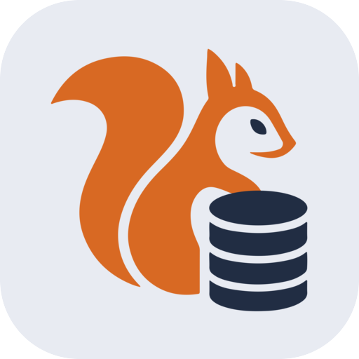

<div align="center">



# SQuirreL

**A free, open-source database manager and SQL client for Linux and Windows.**
Browse, edit and query **SQLite** and **PostgreSQL** databases from a fast, keyboard-friendly desktop GUI.

[](LICENSE)
[](https://github.com/ExilasP/SQuirreL/releases)
[](https://github.com/ExilasP/SQuirreL/actions/workflows/release.yml)


[Download](#download) · [Features](#features) · [Shortcuts](#keyboard-shortcuts) · [Build from source](#build-from-source) · [Roadmap](#roadmap) · [Contributing](#contributing)

</div>

---

SQuirreL is a lightweight alternative to DBeaver, pgAdmin, TablePlus or DB Browser for SQLite: one app to open several databases side by side, explore their schema, edit rows inline, write SQL with syntax highlighting and visualise relations as an **ER diagram**. No account, no telemetry, no paid tier.

## Download

Grab the latest build from the [**Releases page**](https://github.com/ExilasP/SQuirreL/releases):

| OS | Package |
|----|---------|
| Linux | `SQuirreL-<version>-x86_64.AppImage` — `chmod +x` it and run |
| Windows | `SQuirreL-<version>-x64-setup.exe` — NSIS installer |

A sample SQLite database is provided in [`samples/demo.db`](samples/demo.db) to try the app right away.

## Features

### Connections
- **SQLite** (local file) and **PostgreSQL** (host/port, optional SSL).
- **Multiple connections** open at the same time, each with its schemas and databases in the sidebar.
- PostgreSQL **roles** viewer: users, groups, privileges and memberships.
- PostgreSQL **user-defined types** (enum, composite, domain, range) browsable per schema.

### Table viewer & data editor
- Paginated, sortable data grid with a raw `WHERE` filter.
- **Inline editing**, row insertion and deletion, `NULL` support for nullable columns, drop-down editor for PostgreSQL enum columns.
- Spreadsheet-like **cell and multi-row selection**, arrow-key navigation, **Ctrl+C copy**.
- **Export to CSV or JSON** (whole table or query result).
- Table sub-views: **Columns**, **Foreign keys**, **Indexes**, **Triggers**, **DDL**, **DBML** and a per-table **ERD**.

### SQL editor
- CodeMirror-based editor with **SQL syntax highlighting** and formatting.
- Run the whole script or only the selection (**Ctrl+Enter**).
- In-app **saved query library**, plus open/save `.sql` files.

### Schema visualisation
- Interactive **entity-relationship diagram** of a whole schema, laid out automatically.

### Productivity
- Tabbed interface, **Ctrl+P quick open** for tables (across every schema) and saved queries, ranked by relevance.
- Resizable sidebar and SQL editor / results split.
- Global keyboard shortcuts (see below).

## Keyboard shortcuts

| Shortcut | Action |
|----------|--------|
| `Ctrl+P` | Search a table or saved query |
| `Ctrl+N` | New query |
| `Ctrl+Enter` | Run query (or selection) |
| `Ctrl+S` | Save query |
| `Ctrl+C` | Copy selected cell or rows |
| `Ctrl+A` | Select all rows of a grid |
| `↑ ↓ ← →` | Move between cells (`Enter` to edit) |
| `Ctrl+W` | Close tab |
| `Ctrl+Tab` / `Ctrl+Shift+Tab` | Next / previous tab |
| `Ctrl+1…9` | Go to tab 1…9 |

## Build from source

Requirements: Node.js 22+ and npm.

```bash
git clone https://github.com/ExilasP/SQuirreL.git
cd SQuirreL
npm install
npm run dev        # start in development mode
npm run typecheck  # type-check the whole project
npm run dist       # package (AppImage on Linux, NSIS installer on Windows)
```

### Project layout
- `src/main/drivers/` — one file per database engine, implementing `Driver` (`types.ts`). Register new engines in `index.ts`.
- `src/main/ipc.ts` — IPC surface; `src/shared/types.ts` — the typed `Api` contract shared with the renderer.
- `src/renderer/src/views/` — Table, Query, Diagram, Roles and Types views; each opens as a tab. The Table view hosts sub-views (Data, Columns, Foreign keys, Indexes, Triggers, DDL, DBML, ERD) in `views/table/`.

Tech stack: Electron, React 19, TypeScript, Tailwind CSS, CodeMirror, React Flow, `better-sqlite3`, `pg`.

## Roadmap

Done: multi-connection ✅ · table viewer ✅ · inline edit/insert/delete ✅ · SQL scripts (run, saved query library) ✅ · ER diagram ✅ · table sub-views (structure, DDL, DBML, ERD) ✅ · keyboard shortcuts ✅ · grid selection with keyboard navigation and copy ✅ · CSV/JSON export ✅ · PostgreSQL roles ✅ · PostgreSQL user-defined types and enum editing ✅ · resizable panes ✅

Next:
- [ ] MySQL / MariaDB driver
- [ ] SSH tunnels
- [ ] Query history
- [ ] Schema editing (create / alter tables)
- [ ] Autocomplete from schema
- [ ] Auto-update from GitHub releases
- [ ] Tests

## Contributing

Issues, ideas and pull requests are welcome! Adding a database engine is a good first contribution: implement `Driver`, register it in `src/main/drivers/index.ts` and extend `DriverId` in `src/shared/types.ts`. Conventions (Conventional Commits, TSDoc, code style) are described in [`AGENTS.md`](AGENTS.md).

If SQuirreL is useful to you, **a ⭐ on GitHub** helps others discover it.

## License

[MIT](LICENSE) © ExilasP
